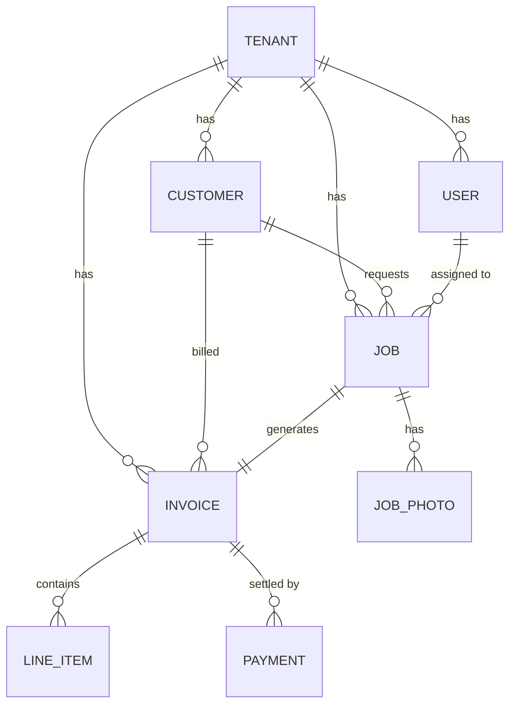
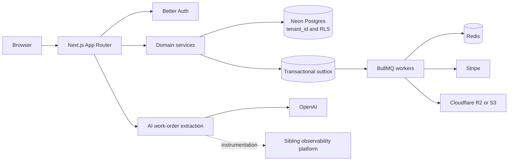

# Field Service ERP

> Multi-tenant ERP slice for HVAC and plumbing businesses. Onboard a company, schedule a technician, complete a job with photos, invoice with line items, collect payment — with AI-assisted extraction from handwritten work orders.

[](https://github.com/OWNER/fieldservice-erp/actions/workflows/ci.yml)
[](./LICENSE)

---

## What this is

A **vertical ERP** — an operating system for one industry's daily business. Not a generic CRM. Every screen is shaped around how a field-service business actually works: customer → job → dispatch → completion → invoice → payment.

It is **not** a full ERP. It is a **3-week, production-shaped slice** of one complete workflow, built to be defended in a code review. Payroll, inventory, scheduling optimization, and compliance modules are deliberately out of scope — the point is to prove domain depth on the slice that matters most, not to boil the ocean.

The AI feature ("extract line items from a photo of a handwritten work order") is **instrumented by a sibling observability platform**. That integration is part of the deliverable.

---

## Why this stack (and why no Kafka)

| Layer | Choice | Why |
|---|---|---|
| Framework | Next.js 16 (App Router) | Server components for dense data views; one deploy target |
| Language | TypeScript (strict) | Non-negotiable for money and domain logic |
| Database | **Neon Postgres** | Serverless, branching per PR for preview envs |
| ORM | **Prisma 7** + `@prisma/adapter-pg` | Type-safe schema, migrations, native Neon support |
| Auth | **Better Auth** (`better-auth` on npm) | Self-hosted, session-based, no vendor lock-in |
| Multi-tenancy | **Postgres RLS + `tenant_id`** | DB-enforced isolation, not app-layer filtering |
| Async jobs | **BullMQ + Redis** | Invoice PDFs, emails, webhook fan-out |
| Outbox | **`outbox_events` table + BullMQ** | Reliable event dispatch without Kafka |
| Payments | **Stripe** (test mode) | Checkout Sessions + idempotent webhooks |
| File storage | **Cloudflare R2 / S3** | Job photos, invoice PDFs — never in Postgres |
| UI | Tailwind + shadcn/ui + TanStack Table | Dense data entry, keyboard nav |
| Testing | Vitest + Playwright | Money math + tenant isolation + one E2E |

### The Kafka decision — read before proposing Kafka

**This project does not use Kafka. This is deliberate.**

1. The ERP's async work is **job-shaped**, not **stream-shaped**: "generate this invoice," "send this email," "sync this payment." BullMQ is built exactly for this.
2. Kafka requires operating a broker/cluster — real operational tax with no MVP benefit.
3. The moat is **domain workflows**, not infrastructure. Every hour on Kafka is an hour not spent on job costing, dispatch logic, or invoice correctness.
4. Reliability is achieved with the **transactional outbox pattern**: every state-changing action writes to `outbox_events` in the same transaction as the domain change; a BullMQ worker drains the outbox and fans out. Same guarantee, no broker.

**When to revisit:** when there are 3+ independent consumer services (analytics + integrations + audit + search) and single-queue throughput is exceeded. That is a month 9–18 decision.

If someone proposes Kafka before then, they must write a note in `docs/DECISIONS.md` addressing the above.

---

## Domain model



## System Architecture

The following diagram describes the **intended architecture** from the project design above. It is not a claim that each service or integration is already implemented.



### Current implementation status

The product scope and stack described above are design intent, not a feature-completion claim. The checked-in application is currently a Next.js scaffold. The Prisma schema defines the PostgreSQL datasource but no application models; the `tests/` directory is empty, and there is no test script or deployment configuration in the package. Several integrations named in the design table are not yet represented by package dependencies or configured services.

## Project Structure

```text
.
├── docs/                 # Architecture and integration notes
├── prisma/               # Prisma schema and configuration
├── public/               # Static assets
├── src/
│   ├── app/               # Next.js App Router pages and styles
│   ├── components/        # Shared UI components
│   ├── hooks/             # React hooks
│   ├── lib/               # Integration and utility areas
│   └── server/            # Server-side domain areas
├── tests/                 # Reserved for tests; currently empty
├── worker/                # Reserved for background workers; currently empty
├── .env.example           # Environment variable names and placeholders
├── package.json           # Scripts and dependencies
└── README.md
```

The application code lives under `src/`; the `lib/` and `server/` subfolders currently indicate intended areas and may not contain working integrations yet.

## Getting Started

### Prerequisites

- Node.js 20.9 or later
- Corepack and pnpm 12.15.0 (the version declared in `package.json`)

### Installation

From the project root:

```bash
corepack enable
pnpm install
```

### Environment Setup

Create a local environment file from the example:

```powershell
Copy-Item .env.example .env
```

On macOS or Linux, use `cp .env.example .env`. The example lists the planned database, authentication, Stripe, Redis, object-storage, and AI configuration keys. Replace placeholders with credentials only for services you have configured. The current scaffold does not yet require or implement all of these integrations. Keep real secrets in `.env`; do not commit them.

### Development Commands

```bash
pnpm dev
```

Open [http://localhost:3000](http://localhost:3000) to view the local development server. Available package scripts:

| Command | Purpose |
|---|---|
| `pnpm dev` | Start the Next.js development server |
| `pnpm lint` | Run ESLint |
| `pnpm build` | Create a production build |
| `pnpm start` | Serve a production build (run `pnpm build` first) |

Prisma migration and test commands are not currently defined in `package.json`.

## Testing Strategy

The design targets Vitest and Playwright, with coverage for money calculations, tenant isolation, and an end-to-end workflow. These tools and tests are not currently present in the repository, and no `pnpm test` script is available. Until a test suite is added, run `pnpm lint` and `pnpm build` to check the existing application.

When tests are introduced, prioritize deterministic unit tests for domain and money logic, integration tests for database and tenant boundaries, and browser-level coverage of the primary customer-to-payment workflow.

## Documentation

- [Domain model](./docs/DOMAIN_MODEL.md) — intended to describe entities, relationships, and tenant boundaries.
- [Architecture decisions](./docs/DECISIONS.md) — intended to record technical decisions.
- [SDK integration](./docs/SDK_INTEGRATION.md) — intended to document the AI extraction SDK.

These documents currently contain brief placeholders; they should be expanded as the corresponding design and implementation are established.

## Development Workflow

1. Install dependencies and create a local `.env` as described above.
2. Make changes in the relevant `src/` area, keeping the design constraints and deliberate out-of-scope items in this README in mind.
3. Run `pnpm lint` and `pnpm build` before submitting changes.
4. Add and run focused tests when test infrastructure is introduced, and update relevant documentation when behavior or architecture changes.

Do not treat planned integrations as available until their implementation and configuration are added.

## Deployment

The project does not currently define a deployment provider or deployment configuration. For a Node.js host compatible with Next.js, build with `pnpm build` and start the production server with `pnpm start`. Configure production environment variables through the host's secret-management facilities; do not deploy local `.env` files. Set up any required external services and database schema changes as part of deployment only after those integrations and models have been implemented.

## License

This project is licensed under the Apache License 2.0. See [LICENSE](./LICENSE) for the full text.
