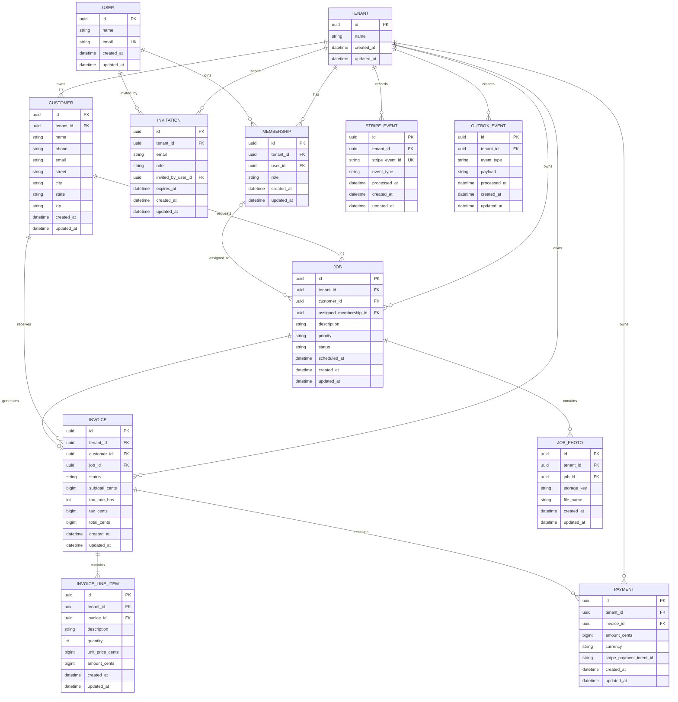
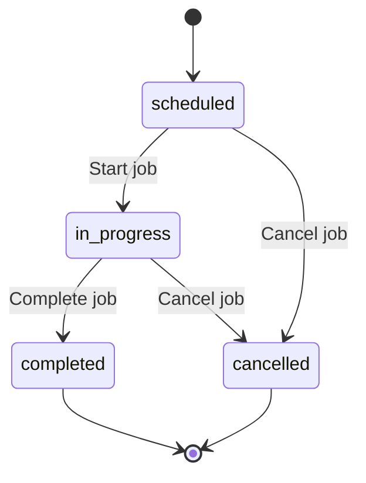
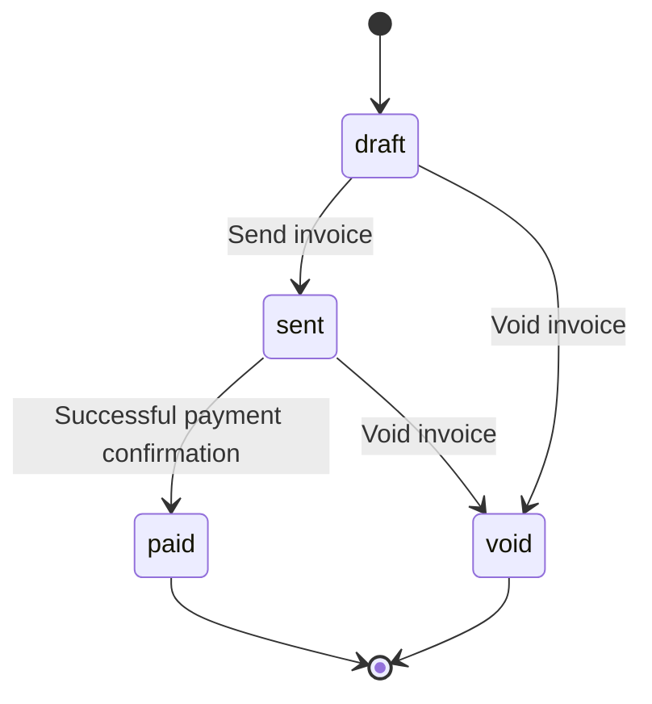

# Domain Model

This document describes the core entities, relationships, business rules, and tenant boundaries of the Field Service ERP.

The application supports multiple service companies using the same platform while keeping each company's data isolated.

## 1. Core Entities

### Tenant
Represents a company using the Field Service ERP. Each tenant has its own customers, jobs, invoices, payments, and users.

### User
Represents an individual account in the system. A user can belong to one or more tenants through memberships.

### Membership
Connects a user to a tenant and defines their role.

Supported roles:
- `owner`: Manages the company, users, customers, jobs, invoices, and payments.
- `technician`: Handles assigned jobs, adds work notes, uploads job photos, and updates job progress.

### Invitation
Stores invitations sent by a tenant owner to new users.

### Customer
Stores customer information, including name, phone number, email, and structured address:
- Street
- City
- State
- ZIP code

### Job
Represents a service task requested by a customer. A job belongs to a customer and can be assigned to a technician.

### JobPhoto
Stores references to photographs uploaded as evidence of work performed on a job. The actual image files will be stored in object storage, not PostgreSQL.

### Invoice
Represents the amount a customer owes for completed work. An invoice belongs to a customer and may be associated with a completed job.

### InvoiceLineItem
Represents an individual charge on an invoice, such as labour, materials, or additional services.

### Payment
Records payments received against invoices.

### StripeEvent
Stores processed Stripe webhook event IDs to prevent duplicate event processing.

### OutboxEvent
Stores business events created by database transactions for reliable background processing through BullMQ workers.

## 2. Entity Relationship Diagram

## 3. Job State Machine

Jobs move through defined stages during the service process.

### Available statuses

- `scheduled`
- `in_progress`
- `completed`
- `cancelled`

### Job transitions

### Who can trigger each transition?

| Transition | Authorized person |
|---|---|
| Create → Scheduled | Owner |
| Scheduled → In Progress | Assigned Technician or Owner |
| In Progress → Completed | Assigned Technician or Owner |
| Scheduled → Cancelled | Owner |
| In Progress → Cancelled | Owner |

A completed or cancelled job cannot be reopened through the normal workflow.

A technician can only update jobs assigned to their membership.

## 4. Invoice State Machine

Invoices have their own lifecycle, separate from jobs.

### Available statuses

- `draft`
- `sent`
- `paid`
- `void`

### Invoice transitions

### Who can trigger each transition?

| Transition | Authorized person |
|---|---|
| Create → Draft | Owner |
| Draft → Sent | Owner |
| Draft → Void | Owner |
| Sent → Paid | Verified Stripe webhook |
| Sent → Void | Owner |

A successful Stripe payment webhook is responsible for confirming payment and changing the invoice status to `paid`.

A paid or void invoice cannot be reopened through the normal workflow.

## 5. Multi-Tenancy and Data Isolation

The system uses a multi-tenant architecture.

Each company is represented by a `Tenant` record. Tenant-owned records must include a `tenant_id` to identify the company that owns them.

### Tenant-owned entities

- Membership
- Invitation
- Customer
- Job
- JobPhoto
- Invoice
- InvoiceLineItem
- Payment
- StripeEvent
- OutboxEvent

The `User` entity represents a global account and is connected to companies through `Membership`.

### Isolation rules

1. Every tenant-owned record must belong to a valid tenant.
2. Users can only access tenant data through an active membership.
3. Owners can manage data belonging to their tenant.
4. Technicians can only access jobs assigned to their membership and the information required to perform those jobs.
5. Database queries must be scoped to the authenticated tenant.
6. PostgreSQL Row-Level Security (RLS) will provide an additional layer of tenant isolation.
7. Composite foreign keys and database constraints should prevent records from being connected across different tenants.

The application database role must use `NOBYPASSRLS` so normal application connections cannot bypass row-level security.

## 6. Important Business Rules

- Every job belongs to one customer.
- A job may be assigned to one technician.
- Job photos belong to a specific job.
- An invoice belongs to one customer and may be linked to one job.
- An invoice contains one or more line items.
- An invoice can receive multiple payment records.
- Stripe webhook events must be processed idempotently.
- Business events must be written to the outbox within the same database transaction as the operation that creates them.
- Background workers process outbox events asynchronously.

## 7. Money and Calculation Reference

All monetary values are stored as integer cents. Floating-point numbers must not be used for financial calculations.

Tax rates are stored as basis points, and labour time is stored as integer minutes.

The detailed calculation and rounding rules are documented in `DECISIONS.md`.

## 8. Implementation Status

This document defines the intended domain model for the Field Service ERP.

The entities and relationships will be implemented in PostgreSQL through Prisma migrations. Tenant isolation will be enforced through application-level authorization, database constraints, and PostgreSQL Row-Level Security.